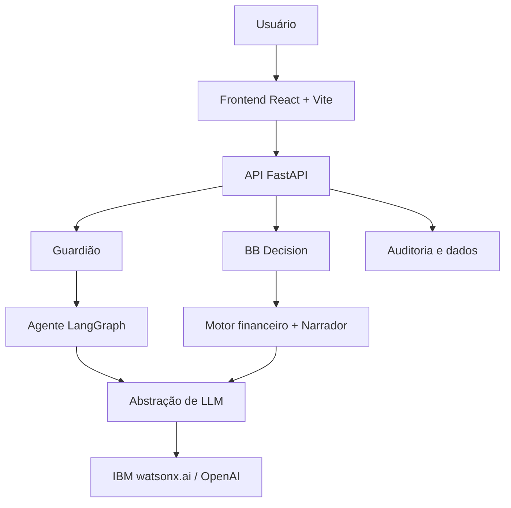

<div align="center">

# 💙 SheTech 💛

### Inteligência que protege. Tecnologia que transforma.

**GUARDIÃO + BB DECISION**

Soluções com Inteligência Artificial para promover segurança digital, educação financeira e decisões mais conscientes.

**Projeto IBM × Banco do Brasil | Serviços Financeiros**

<br>


<br>

**[Sobre](#-sobre-o-projeto) • [Soluções](#-nossas-soluções) • [Tecnologias](#-tecnologias-utilizadas) • [Instalação](#-como-executar-o-projeto) • [Equipe](#-conheça-a-shetech)**

</div>

---

## 👩‍💻 Conheça a SheTech

<div align="center">

### Três mulheres. Duas soluções. Um propósito.

A **SheTech** é formada por três integrantes que compartilham o interesse por tecnologia, inovação e criação de soluções com impacto positivo.

Nosso trabalho une criatividade, desenvolvimento de software, Inteligência Artificial e experiência do usuário.

<br>

<table>
<tr>
<td align="center" width="200">

<a href="https://github.com/GiovannaMontoro">

<br>
<strong>Giovanna Montoro</strong>
</a>

<br>
<sub>@GiovannaMontoro</sub>

</td>
<td align="center" width="200">

<a href="https://github.com/marianoronha">

<br>
<strong>Maria Noronha</strong>
</a>

<br>
<sub>@marianoronha</sub>

</td>
<td align="center" width="200">

<a href="https://github.com/LaraAntuness">

<br>
<strong>Lara Antunes</strong>
</a>

<br>
<sub>@LaraAntuness</sub>

</td>
</tr>
</table>

<br>

**Clique nas fotos para conhecer os perfis de cada integrante no GitHub.**

*Tecnologia, colaboração e inovação para transformar ideias em soluções.*

</div>

---

## 🌍 Impacto esperado

Com o Guardião e o BB Decision, buscamos:

- 🛡️ Ampliar a conscientização sobre golpes digitais.
- 💬 Facilitar o acesso a informações de segurança.
- 🎮 Transformar aprendizado em experiências práticas.
- 📊 Incentivar decisões financeiras mais conscientes.
- 💙 Promover uma experiência digital mais acessível.
- 🚀 Explorar o potencial da IA aplicada a desafios reais.

---

## ✨ Sobre o projeto

E se a Inteligência Artificial pudesse ajudar você a identificar golpes antes de cair neles e compreender os impactos das suas decisões financeiras antes de tomá-las?

Foi a partir dessa ideia que nasceu o nosso projeto.

Desenvolvido pela equipe **SheTech**, no contexto do projeto IBM × Banco do Brasil, o sistema reúne duas soluções que compartilham um propósito: tornar a experiência financeira mais segura, inteligente e acessível.

O projeto é composto por:

- 🛡️ **Guardião:** uma solução de IA voltada à prevenção de golpes de engenharia social, orientação e educação digital.
- 📊 **BB Decision:** um simulador inteligente que permite explorar cenários financeiros e compreender possíveis consequências de decisões.

Mais do que utilizar Inteligência Artificial, buscamos desenvolver experiências que considerem o contexto, a necessidade e a realidade de cada usuário.

> **Nossa missão:** transformar tecnologia em autonomia, proteção e conhecimento.

---

## 🎯 O problema

O cotidiano financeiro envolve decisões que podem afetar diretamente a segurança e o bem-estar das pessoas.

Identificamos dois desafios principais:

<table>
<tr>
<td width="50%" valign="top">

<h3>🛡️ Golpes digitais</h3>

<p>Golpes de engenharia social utilizam mensagens falsas, senso de urgência e manipulação emocional para induzir vítimas a compartilhar informações ou transferir dinheiro.</p>

<p>A simples identificação de palavras suspeitas nem sempre é suficiente para compreender uma tentativa de fraude.</p>

<p><strong>Nosso desafio:</strong> identificar sinais de risco e orientar o usuário antes que ele seja prejudicado.</p>

</td>
<td width="50%" valign="top">

<h3>📊 Decisões financeiras</h3>

<p>Compras parceladas, mudanças de renda e outros compromissos financeiros podem gerar consequências difíceis de prever.</p>

<p>Muitas pessoas tomam decisões sem conseguir visualizar claramente seus possíveis impactos.</p>

<p><strong>Nosso desafio:</strong> oferecer ferramentas que tornem o planejamento mais acessível e compreensível.</p>

</td>
</tr>
</table>

---

## 🚀 Nossas soluções

<div align="center">

<table>
<tr>
<td align="center" width="50%">


<h3>🛡️ Guardião</h3>

<p><strong>Sua segurança em primeiro lugar.</strong></p>

<p>Análise inteligente de possíveis golpes, explicações acessíveis e experiências educativas para prevenção de fraudes.</p>

</td>
<td align="center" width="50%">


<h3>📈 BB Decision</h3>

<p><strong>Suas escolhas, seu futuro.</strong></p>

<p>Simulações financeiras para explorar possibilidades e compreender os impactos de diferentes decisões.</p>

</td>
</tr>
</table>

</div>

---

# 🛡️ Guardião

### Proteção que vai além de um alerta.

O **Guardião** é uma solução de Inteligência Artificial desenvolvida para auxiliar na identificação de golpes de engenharia social e promover a educação em segurança digital.

Seu objetivo é analisar conteúdos suspeitos, identificar sinais de fraude e apresentar explicações claras para o usuário.

A proposta considera não apenas palavras isoladas, mas também o contexto e a intenção por trás das mensagens.

### 🔍 Principais funcionalidades

| Funcionalidade | Descrição |
|---|---|
| 🔎 Análise de mensagens | Identificação de indícios de golpes e engenharia social |
| 📊 Indicador de risco | Apresentação do risco estimado de fraude |
| 💡 Explicação de golpes | Informações sobre o tipo de golpe e como funciona |
| 💬 Chat de dúvidas | Orientações sobre segurança digital e golpes frequentes |
| 🎮 Testes interativos | Situações práticas para aprender a identificar fraudes |
| 🛡️ Recomendações | Orientações para prevenção e proteção |

### ⚙️ Como funciona?

O fluxo de análise do Guardião utiliza um agente desenvolvido com **LangGraph**, organizado em seis nós.

A arquitetura permite estruturar etapas de processamento e análise, utilizando modelos de linguagem para interpretar informações.

De maneira simplificada:

**Entrada do usuário → Processamento → Análise por IA → Avaliação de risco → Explicação e orientação**

### 💬 Chat de dúvidas frequentes

O Guardião também possui uma experiência voltada a esclarecer dúvidas sobre segurança digital.

O objetivo é oferecer orientações acessíveis para perguntas relacionadas a golpes, mensagens suspeitas e cuidados com informações pessoais.

### 🎮 Aprendizado na prática

Além de identificar possíveis golpes, o projeto busca ensinar o usuário a reconhecê-los.

No ambiente de testes interativos, são apresentadas situações nas quais a pessoa deve avaliar se determinada mensagem ou abordagem representa um golpe.

Após responder, o usuário recebe um retorno educativo.

Dessa forma, o Guardião promove não apenas proteção, mas também **conscientização e autonomia digital**.

---

# 📊 BB Decision

### O futuro das suas decisões começa com uma pergunta.

O **BB Decision** é um simulador financeiro inteligente que permite ao usuário explorar diferentes possibilidades antes de tomar decisões importantes.

A experiência parte de uma pergunta simples:

### "E se eu fizer isso?"

Utilizando Inteligência Artificial e um motor de cálculos financeiros, o sistema busca interpretar perguntas em linguagem natural e apresentar cenários de forma compreensível.

### 💡 Exemplos de utilização

| Pergunta | O que pode ser analisado |
|---|---|
| 🛍️ E se eu parcelar uma compra? | Impacto das parcelas no orçamento |
| 💰 E se minha renda diminuir? | Possíveis efeitos sobre despesas e reserva |
| 🏠 E se eu comprar uma casa? | Comprometimento da renda e metas |
| 🎯 E se eu quiser economizar mais? | Alternativas de planejamento |
| 💼 E se eu mudar de emprego? | Mudanças no cenário financeiro |

### ⚙️ Como funciona?

O BB Decision combina interpretação de linguagem natural com processamento financeiro estruturado.

Seu backend possui um motor financeiro e um componente responsável pela apresentação dos resultados em linguagem compreensível.

**Pergunta → Interpretação → Cálculos financeiros → Simulação → Explicação**

A Inteligência Artificial auxilia na interpretação e na comunicação dos resultados. Os cálculos devem seguir regras financeiras confiáveis e verificáveis.

### 🌟 Nosso diferencial

O BB Decision não busca apenas apresentar números.

Nossa proposta é transformar informações financeiras em explicações acessíveis, permitindo que o usuário compare possibilidades e compreenda melhor suas escolhas.

> As simulações são estimativas para fins informativos e demonstrativos. Não representam garantias de resultados futuros nem recomendações de investimento.

---

## 🧠 Inteligência Artificial

O projeto utiliza uma arquitetura que permite trabalhar com diferentes provedores de modelos de linguagem.

Entre as opções previstas estão:

- **IBM watsonx.ai**
- **OpenAI**

A seleção do provedor é configurada por meio da variável de ambiente `LLM_PROVIDER`.

### Aplicações de IA

| Guardião | BB Decision |
|---|---|
| Análise de mensagens suspeitas | Interpretação de perguntas financeiras |
| Identificação de sinais de engenharia social | Explicação de cenários |
| Processamento contextual | Comparação de alternativas |
| Orientações de segurança | Apoio ao planejamento |
| Agente estruturado com LangGraph | Motor financeiro e narrador |

A arquitetura busca utilizar a IA para interpretação e explicação, mantendo cálculos e operações críticas sujeitos a mecanismos apropriados de validação.

---

## 🛠️ Tecnologias utilizadas

<div align="center">


</div>

### Backend

- Python 3.12
- FastAPI
- LangGraph
- SQLAlchemy
- IBM watsonx.ai / OpenAI
- Pytest

### Frontend

- React
- Vite
- JavaScript
- CSS

### Organização técnica

O sistema conta com separação entre frontend e backend, APIs REST, componentes específicos para cada solução e abstração para provedores de IA.

---

## 🏗️ Arquitetura do sistema

A aplicação é organizada em componentes independentes para favorecer manutenção, desenvolvimento e evolução das funcionalidades.



### Componentes principais

**Frontend:** responsável pela interface, navegação e interação do usuário.

**API FastAPI:** recebe as requisições e conecta as interfaces aos serviços.

**Guardião:** possui um agente estruturado com LangGraph.

**BB Decision:** combina processamento financeiro e explicação dos resultados.

**Camada LLM:** oferece abstração para comunicação com os provedores de Inteligência Artificial.

**Auditoria e dados:** componentes voltados ao registro estruturado e à organização de informações da aplicação.

---

## 💻 Como executar o projeto

### Pré-requisitos

| Ferramenta | Versão mínima |
|---|---|
| Python | 3.12 |
| Node.js | 20 LTS |
| pip | 23+ |

### 1. Configurar o ambiente

Na pasta raiz do repositório:

```bash
cp .env.example .env
```

No Windows PowerShell, utilize:

```powershell
Copy-Item .env.example .env
```

Edite o arquivo `.env` com as credenciais necessárias.

**Nunca compartilhe ou versione arquivos que contenham chaves de API.**

### Variáveis de ambiente

| Variável | Descrição |
|---|---|
| `LLM_PROVIDER` | `watsonx` (padrão) ou `openai` |
| `WATSONX_API_KEY` | Chave da API IBM watsonx.ai |
| `WATSONX_PROJECT_ID` | ID do projeto IBM watsonx |
| `WATSONX_URL` | URL da instância watsonx (padrão: us-south) |
| `WATSONX_MODEL_ID` | Modelo utilizado (padrão: `ibm/granite-13b-chat-v2`) |
| `OPENAI_API_KEY` | Obrigatória apenas quando `LLM_PROVIDER=openai` |

### 2. Executar o backend

A partir da raiz do repositório:

```bash
cd backend
python -m venv .venv
```

Ative o ambiente virtual.

**Windows PowerShell:**

```powershell
.\.venv\Scripts\Activate.ps1
```

**Linux/Mac:**

```bash
source .venv/bin/activate
```

Instale as dependências e inicie a API:

```bash
python -m pip install -r requirements.txt
uvicorn app.main:app --reload --port 8000
```

**Endereços locais:**

- API: http://localhost:8000
- Documentação interativa: http://localhost:8000/docs

### 3. Executar o frontend

Em outro terminal, a partir da raiz do repositório:

```bash
cd frontend
npm install
npm run dev
```

A aplicação estará disponível em:

**http://localhost:5173**

> O frontend utiliza o proxy do Vite para encaminhar requisições `/api/*` ao backend local.

Para configurar outro endereço de backend, crie um arquivo `.env` na pasta `frontend/`:

```env
VITE_API_URL=http://seu-backend:8000
```

---

## 🧪 Testes

O repositório inclui testes automatizados para auxiliar na validação das funcionalidades.

### Backend

Na pasta `backend/`:

```bash
pytest tests/ -v --tb=short
```

Para verificar a cobertura:

```bash
pytest tests/ --cov=app --cov-report=term-missing
```

### Frontend

Na pasta `frontend/`:

```bash
npm test
```

Para executar em modo de observação:

```bash
npm run test:watch
```

---

## 📁 Estrutura do projeto

```text
bb-ia-mvp/
├── backend/
│   ├── app/
│   │   ├── main.py
│   │   ├── api/
│   │   ├── guardiao/
│   │   ├── bbdecision/
│   │   ├── llm/
│   │   ├── audit/
│   │   ├── data/
│   │   └── db/
│   └── tests/
│
├── frontend/
│   └── src/
│       └── img/
│           ├── MascoteComEscudo2.png
│           └── Amascote.png
│
├── docs/
├── .env.example
├── .gitignore
└── README.md
```

**Descrição das pastas:**

- `api/` — rotas REST da aplicação.
- `guardiao/` — agente LangGraph organizado em seis nós.
- `bbdecision/` — motor financeiro e narrador.
- `llm/` — abstração de provedores IBM watsonx.ai e OpenAI.
- `audit/` — logs estruturados em JSON.
- `data/` — dados sintéticos.
- `db/` — modelos SQLAlchemy.
- `tests/` — testes automatizados.
- `docs/` — documentação técnica e relatórios.
- `frontend/src/img/` — recursos visuais e mascotes do projeto.

---

## 🔒 Segurança e IA responsável

A segurança e a responsabilidade no uso da IA são aspectos importantes do projeto.

### Medidas documentadas

- Credenciais mantidas fora dos arquivos versionados.
- Sanitização de entradas antes do processamento pelos modelos de linguagem.
- Mecanismos de proteção contra prompt injection.
- Logs de auditoria sem dados pessoais identificáveis.
- Utilização de dados sintéticos.

### Privacidade

Os dados de usuários, transações e casos de teste utilizados no protótipo são **100% fictícios**.

Nenhum dado real de clientes é utilizado nas demonstrações documentadas.

### Limitações

O projeto é um protótipo funcional para fins de desenvolvimento, estudo e demonstração.

- A análise de risco não garante a identificação de todos os golpes.
- Os resultados de IA podem exigir verificação.
- Simulações financeiras representam estimativas.
- Decisões críticas devem contar com validações e supervisão adequadas.

---

## 📚 Documentação adicional

| Documento | Localização |
|---|---|
| Arquitetura e decisões técnicas | `docs/architecture.md` |
| Especificação OpenAPI | `docs/openapi.yaml` |
| Matriz de rastreabilidade | `docs/traceability_matrix.md` |
| Relatório de IA responsável | `docs/responsible_ai_report.md` |

A documentação reúne detalhes sobre a organização técnica, os serviços e os princípios adotados no desenvolvimento.

---

## ⚖️ Aviso legal

Este projeto possui caráter demonstrativo e foi desenvolvido no contexto do projeto IBM × Banco do Brasil.

As soluções não devem ser interpretadas como serviços bancários oficiais em produção.

As análises de golpes são recursos de apoio à identificação de riscos, enquanto as simulações financeiras são estimativas informativas.

---

<div align="center">

### 💙 Tecnologia com propósito. Inovação com impacto. 💛

**SheTech | Guardião + BB Decision**

*Protegendo escolhas. Transformando futuros.*

</div>
