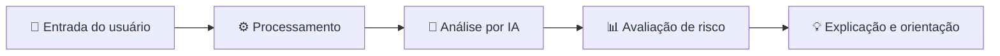
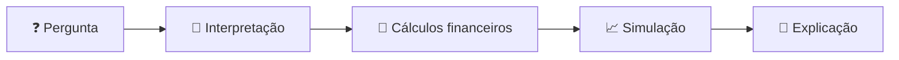
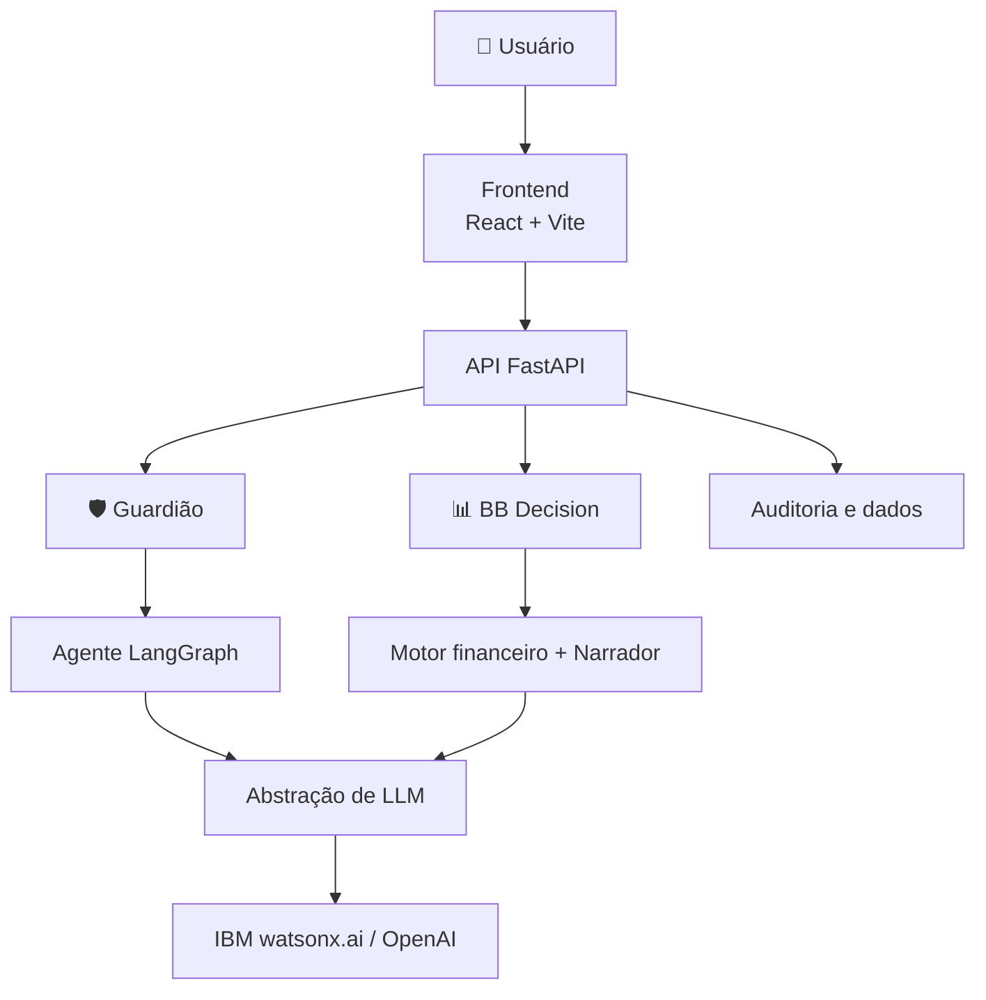

<div align="center">

# 💙 SheTech 💛

### Inteligência que protege. Tecnologia que transforma.

**🛡️ Guardião &nbsp;+&nbsp; 📊 BB Decision**

Soluções com Inteligência Artificial para promover segurança digital,<br>
educação financeira e decisões mais conscientes.

**Projeto IBM × Banco do Brasil · Serviços Financeiros**

<br>


<br>

**[Sobre](#-sobre-o-projeto) · [Soluções](#-nossas-soluções) · [Arquitetura](#-arquitetura) · [Como executar](#-como-executar) · [Segurança](#-segurança-e-ia-responsável) · [Equipe](#-equipe)**

</div>

---

## 📑 Sumário

- [Sobre o projeto](#-sobre-o-projeto)
- [O problema](#-o-problema)
- [Nossas soluções](#-nossas-soluções)
  - [Guardião](#️-guardião)
  - [BB Decision](#-bb-decision)
- [Inteligência Artificial](#-inteligência-artificial)
- [Tecnologias](#️-tecnologias)
- [Arquitetura](#-arquitetura)
- [Como executar](#-como-executar)
- [Testes](#-testes)
- [Estrutura do projeto](#-estrutura-do-projeto)
- [Segurança e IA responsável](#-segurança-e-ia-responsável)
- [Documentação adicional](#-documentação-adicional)
- [Equipe](#-equipe)
- [Aviso legal](#️-aviso-legal)

---

## ✨ Sobre o projeto

> **E se a Inteligência Artificial pudesse ajudar você a identificar golpes antes de cair neles e a compreender os impactos das suas decisões financeiras antes de tomá-las?**

Foi dessa pergunta que nasceu o projeto da equipe **SheTech**, desenvolvido no contexto da parceria **IBM × Banco do Brasil**.

O sistema reúne duas soluções com um propósito em comum: tornar a experiência financeira **mais segura, inteligente e acessível**.

| | Solução | Em uma frase |
|---|---|---|
| 🛡️ | **Guardião** | IA para prevenção de golpes de engenharia social, orientação e educação digital. |
| 📊 | **BB Decision** | Simulador financeiro inteligente para explorar cenários e entender consequências. |

> **Nossa missão:** transformar tecnologia em autonomia, proteção e conhecimento.

### 🌍 Impacto esperado

- 🛡️ Ampliar a conscientização sobre golpes digitais.
- 💬 Facilitar o acesso a informações de segurança.
- 🎮 Transformar aprendizado em experiências práticas.
- 📊 Incentivar decisões financeiras mais conscientes.
- 💙 Promover uma experiência digital mais acessível.
- 🚀 Explorar o potencial da IA aplicada a desafios reais.

---

## 🎯 O problema

O cotidiano financeiro envolve decisões que afetam diretamente a segurança e o bem-estar das pessoas. Identificamos dois desafios principais:

<table>
<tr>
<td width="50%" valign="top">

### 🛡️ Golpes digitais

Golpes de engenharia social usam mensagens falsas, senso de urgência e manipulação emocional para induzir vítimas a compartilhar informações ou transferir dinheiro.

Identificar apenas palavras suspeitas nem sempre basta para reconhecer uma tentativa de fraude.

**Nosso desafio:** identificar sinais de risco e orientar o usuário *antes* que ele seja prejudicado.

</td>
<td width="50%" valign="top">

### 📊 Decisões financeiras

Compras parceladas, mudanças de renda e outros compromissos podem gerar consequências difíceis de prever.

Muitas pessoas decidem sem conseguir visualizar claramente os possíveis impactos.

**Nosso desafio:** oferecer ferramentas que tornem o planejamento mais acessível e compreensível.

</td>
</tr>
</table>

---

## 🚀 Nossas soluções

<div align="center">

<table>
<tr>
<td align="center" width="50%">


### 🛡️ Guardião

**Sua segurança em primeiro lugar.**

Análise inteligente de possíveis golpes, explicações acessíveis e experiências educativas.

</td>
<td align="center" width="50%">


### 📈 BB Decision

**Suas escolhas, seu futuro.**

Simulações financeiras para explorar possibilidades e entender o impacto de cada decisão.

</td>
</tr>
</table>

</div>

---

### 🛡️ Guardião

> *Proteção que vai além de um alerta.*

O Guardião analisa conteúdos suspeitos, identifica sinais de fraude e apresenta explicações claras ao usuário. A análise considera **o contexto e a intenção** por trás das mensagens, e não apenas palavras isoladas.

#### 🔍 Funcionalidades

| Funcionalidade | Descrição |
|---|---|
| 🔎 **Análise de mensagens** | Identifica indícios de golpes e engenharia social |
| 📊 **Indicador de risco** | Apresenta o risco estimado de fraude |
| 💡 **Explicação de golpes** | Mostra o tipo de golpe e como ele funciona |
| 💬 **Chat de dúvidas** | Orienta sobre segurança digital e golpes frequentes |
| 🎮 **Testes interativos** | Situações práticas para aprender a reconhecer fraudes |
| 🛡️ **Recomendações** | Orientações de prevenção e proteção |

#### ⚙️ Como funciona

O fluxo de análise usa um agente construído com **LangGraph**, organizado em **seis nós**, que estruturam as etapas de processamento e utilizam modelos de linguagem para interpretar o conteúdo.



#### 🎮 Aprendizado na prática

Além de identificar golpes, o Guardião ensina a reconhecê-los. Nos **testes interativos**, o usuário avalia se uma mensagem ou abordagem é um golpe e, após responder, recebe um **retorno educativo**.

Assim, o Guardião promove não só proteção, mas também **conscientização e autonomia digital**.

---

### 📊 BB Decision

> *O futuro das suas decisões começa com uma pergunta.*

O BB Decision parte de uma pergunta simples:

### "E se eu fizer isso?"

Com IA e um motor de cálculos financeiros, o sistema interpreta perguntas em linguagem natural e apresenta cenários de forma compreensível.

#### 💡 Exemplos de uso

| Pergunta | O que pode ser analisado |
|---|---|
| 🛍️ E se eu parcelar uma compra? | Impacto das parcelas no orçamento |
| 💰 E se minha renda diminuir? | Efeitos sobre despesas e reserva |
| 🏠 E se eu comprar uma casa? | Comprometimento da renda e metas |
| 🎯 E se eu quiser economizar mais? | Alternativas de planejamento |
| 💼 E se eu mudar de emprego? | Mudanças no cenário financeiro |

#### ⚙️ Como funciona

O backend combina interpretação de linguagem natural com processamento financeiro estruturado: um **motor financeiro** faz os cálculos e um **narrador** apresenta os resultados em linguagem acessível.



> **Princípio de design:** a IA auxilia na *interpretação* e na *comunicação*. Os cálculos seguem regras financeiras confiáveis e verificáveis.

#### 🌟 Nosso diferencial

O BB Decision não apenas mostra números: transforma informações financeiras em explicações acessíveis, permitindo comparar possibilidades e entender melhor cada escolha.

> ⚠️ As simulações são estimativas para fins informativos e demonstrativos. Não representam garantia de resultados futuros nem recomendação de investimento.

---

## 🧠 Inteligência Artificial

A arquitetura permite trabalhar com diferentes provedores de modelos de linguagem:

- **IBM watsonx.ai** *(padrão)*
- **OpenAI**

O provedor é escolhido pela variável de ambiente `LLM_PROVIDER`.

| 🛡️ Guardião | 📊 BB Decision |
|---|---|
| Análise de mensagens suspeitas | Interpretação de perguntas financeiras |
| Identificação de sinais de engenharia social | Explicação de cenários |
| Processamento contextual | Comparação de alternativas |
| Orientações de segurança | Apoio ao planejamento |
| Agente estruturado com LangGraph | Motor financeiro e narrador |

A IA é usada para **interpretação e explicação**; cálculos e operações críticas ficam sujeitos a mecanismos apropriados de validação.

---

## 🛠️ Tecnologias

<div align="center">


</div>

| Camada | Tecnologias |
|---|---|
| **Backend** | Python 3.12, FastAPI, LangGraph, SQLAlchemy, Pytest |
| **Frontend** | React, Vite, JavaScript, CSS |
| **IA** | IBM watsonx.ai, OpenAI |

O sistema separa frontend e backend, expõe APIs REST, organiza componentes específicos para cada solução e abstrai os provedores de IA.

---

## 🏗️ Arquitetura

A aplicação é dividida em componentes independentes, o que facilita a manutenção e a evolução das funcionalidades.



| Componente | Responsabilidade |
|---|---|
| **Frontend** | Interface, navegação e interação do usuário |
| **API FastAPI** | Recebe requisições e conecta a interface aos serviços |
| **Guardião** | Agente estruturado com LangGraph |
| **BB Decision** | Processamento financeiro e explicação dos resultados |
| **Camada LLM** | Abstração para comunicação com os provedores de IA |
| **Auditoria e dados** | Registro estruturado e organização das informações |

---

## 💻 Como executar

### Pré-requisitos

| Ferramenta | Versão mínima |
|---|---|
| Python | 3.12 |
| Node.js | 20 LTS |
| pip | 23+ |

### 1️⃣ Configurar o ambiente

Na raiz do repositório:

```bash
cp .env.example .env
```

No Windows PowerShell:

```powershell
Copy-Item .env.example .env
```

Edite o `.env` com as credenciais necessárias.

> 🔐 **Nunca compartilhe nem versione arquivos que contenham chaves de API.**

<details>
<summary><b>📋 Variáveis de ambiente</b></summary>

<br>

| Variável | Descrição |
|---|---|
| `LLM_PROVIDER` | `watsonx` (padrão) ou `openai` |
| `WATSONX_API_KEY` | Chave da API IBM watsonx.ai |
| `WATSONX_PROJECT_ID` | ID do projeto IBM watsonx |
| `WATSONX_URL` | URL da instância watsonx (padrão: us-south) |
| `WATSONX_MODEL_ID` | Modelo utilizado (padrão: `ibm/granite-13b-chat-v2`) |
| `OPENAI_API_KEY` | Obrigatória apenas quando `LLM_PROVIDER=openai` |

</details>

### 2️⃣ Executar o backend

```bash
cd backend
python -m venv .venv
```

Ative o ambiente virtual:

```bash
# Linux / macOS
source .venv/bin/activate
```

```powershell
# Windows PowerShell
.\.venv\Scripts\Activate.ps1
```

Instale as dependências e inicie a API:

```bash
python -m pip install -r requirements.txt
uvicorn app.main:app --reload --port 8000
```

| Recurso | Endereço |
|---|---|
| API | http://localhost:8000 |
| Documentação interativa | http://localhost:8000/docs |

### 3️⃣ Executar o frontend

Em outro terminal, a partir da raiz do repositório:

```bash
cd frontend
npm install
npm run dev
```

A aplicação estará em **http://localhost:5173**.

> 💡 O frontend usa o proxy do Vite para encaminhar requisições `/api/*` ao backend local.
>
> Para apontar para outro backend, crie um `.env` em `frontend/`:
>
> ```env
> VITE_API_URL=http://seu-backend:8000
> ```

---

## 🧪 Testes

<table>
<tr>
<td width="50%" valign="top">

**Backend** (`backend/`)

```bash
pytest tests/ -v --tb=short
```

Cobertura:

```bash
pytest tests/ --cov=app --cov-report=term-missing
```

</td>
<td width="50%" valign="top">

**Frontend** (`frontend/`)

```bash
npm test
```

Modo de observação:

```bash
npm run test:watch
```

</td>
</tr>
</table>

---

## 📁 Estrutura do projeto

```text
bb-ia-mvp/
├── backend/
│   ├── app/
│   │   ├── main.py
│   │   ├── api/          # rotas REST
│   │   ├── guardiao/     # agente LangGraph (6 nós)
│   │   ├── bbdecision/   # motor financeiro e narrador
│   │   ├── llm/          # abstração watsonx.ai / OpenAI
│   │   ├── audit/        # logs estruturados em JSON
│   │   ├── data/         # dados sintéticos
│   │   └── db/           # modelos SQLAlchemy
│   └── tests/            # testes automatizados
│
├── frontend/
│   └── src/
│
├── docs/                 # documentação técnica e relatórios
│
├── .env.example
├── .gitignore
└── README.md
```

---

## 🔒 Segurança e IA responsável

### Medidas documentadas

- ✅ Credenciais mantidas fora dos arquivos versionados.
- ✅ Sanitização de entradas antes do processamento pelos modelos de linguagem.
- ✅ Mecanismos de proteção contra *prompt injection*.
- ✅ Logs de auditoria sem dados pessoais identificáveis.
- ✅ Uso de dados sintéticos.

### Privacidade

Os dados de usuários, transações e casos de teste usados no protótipo são **100% fictícios**. Nenhum dado real de clientes é utilizado nas demonstrações.

### Limitações

O projeto é um **protótipo funcional** para desenvolvimento, estudo e demonstração.

- A análise de risco não garante a identificação de todos os golpes.
- Os resultados de IA podem exigir verificação.
- Simulações financeiras são estimativas.
- Decisões críticas devem contar com validação e supervisão adequadas.

---

## 📚 Documentação adicional

| Documento | Localização |
|---|---|
| Arquitetura e decisões técnicas | [`docs/architecture.md`](docs/architecture.md) |
| Especificação OpenAPI | [`docs/openapi.yaml`](docs/openapi.yaml) |
| Matriz de rastreabilidade | [`docs/traceability_matrix.md`](docs/traceability_matrix.md) |
| Relatório de IA responsável | [`docs/responsible_ai_report.md`](docs/responsible_ai_report.md) |

---

## 👩‍💻 Equipe

<div align="center">

### Três mulheres. Duas soluções. Um propósito.

A **SheTech** reúne três integrantes com interesse em tecnologia, inovação e soluções de impacto positivo, unindo criatividade, desenvolvimento de software, Inteligência Artificial e experiência do usuário.

<br>

<table>
<tr>
<td align="center" width="200">
<a href="https://github.com/GiovannaMontoro">
<br>
<strong>Giovanna Montoro</strong>
</a><br>
<sub>@GiovannaMontoro</sub>
</td>
<td align="center" width="200">
<a href="https://github.com/marianoronha">
<br>
<strong>Maria Noronha</strong>
</a><br>
<sub>@marianoronha</sub>
</td>
<td align="center" width="200">
<a href="https://github.com/LaraAntuness">
<br>
<strong>Lara Antunes</strong>
</a><br>
<sub>@LaraAntuness</sub>
</td>
</tr>
</table>

<sub>Clique nas fotos para conhecer o perfil de cada integrante no GitHub.</sub>

</div>

---

## ⚖️ Aviso legal

Este projeto tem caráter **demonstrativo** e foi desenvolvido no contexto da parceria IBM × Banco do Brasil. As soluções **não** devem ser interpretadas como serviços bancários oficiais em produção.

As análises de golpes são recursos de apoio à identificação de riscos, e as simulações financeiras são estimativas informativas.

---

<div align="center">

### 💙 Tecnologia com propósito. Inovação com impacto. 💛

**SheTech · Guardião + BB Decision**

*Protegendo escolhas. Transformando futuros.*

</div>
