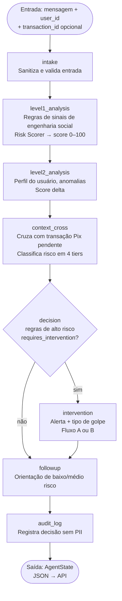
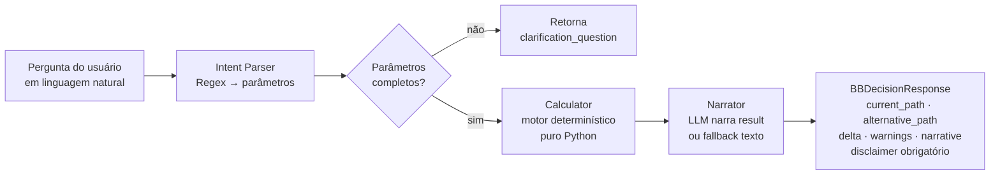

# Arquitetura — BB IA MVP

> Versão: 0.1.0 | Atualizado: 2025 | Classificação: Protótipo / Não-produção

---

## 1. Visão Geral

O MVP integra duas soluções de IA independentes servidas por um único backend FastAPI:

| Solução | Função |
|---|---|
| **Guardião** | Sistema agêntico (LangGraph) de detecção e intervenção em golpes de engenharia social, com foco em fraudes Pix |
| **BB Decision** | Simulador de decisões financeiras ("E se eu fizer X?"). Motor determinístico; LLM apenas narra |

```
┌─────────────────────────────────────────────────────────┐
│                   Cliente (Browser)                      │
│            React + Vite  ─  localhost:5173               │
└──────────────┬───────────────────────────┬──────────────┘
               │ /api/guardiao/*           │ /api/bbdecision/*
               ▼                           ▼
┌─────────────────────────────────────────────────────────┐
│              FastAPI  ─  localhost:8000                  │
│  ┌─────────────────────┐  ┌──────────────────────────┐  │
│  │   Router Guardião   │  │   Router BB Decision     │  │
│  └────────┬────────────┘  └──────────┬───────────────┘  │
│           │                          │                   │
│  ┌────────▼────────────┐  ┌──────────▼───────────────┐  │
│  │  Agente LangGraph   │  │  Intent Parser (regex)   │  │
│  │  (grafo de 8 nós)   │  │  + Calculator (determin.)│  │
│  └────────┬────────────┘  └──────────┬───────────────┘  │
│           │                          │                   │
│  ┌────────▼────────────────────────────────────────────┐ │
│  │         LLM Provider (mock / watsonx.ai / openai)  │ │
│  └─────────────────────────────────────────────────────┘ │
└─────────────────────────────────────────────────────────┘
```

---

## 2. Stack Tecnológica

### Backend
| Componente | Tecnologia | Versão mínima |
|---|---|---|
| Linguagem | Python | 3.11+ |
| Framework HTTP | FastAPI | 0.111+ |
| Grafo agêntico | LangGraph | 0.2+ |
| Validação | Pydantic v2 | 2.7+ |
| Servidor ASGI | Uvicorn | 0.30+ |
| Testes | Pytest + pytest-asyncio | — |

### Frontend
| Componente | Tecnologia |
|---|---|
| Framework | React 18 + TypeScript |
| Build tool | Vite 5 |
| Estilização | CSS Modules / global.css |
| HTTP client | fetch (nativo) |

### LLM (opcional)
| Provedor | Status |
|---|---|
| Mock (determinístico) | ✅ Padrão (não requer credenciais) |
| watsonx.ai (IBM) | ⬜ Configurável via `.env` |
| OpenAI | ⬜ Configurável via `.env` |

---

## 3. Grafo Agêntico — Guardião

O Guardião é implementado como um grafo de estados (LangGraph `StateGraph`) com **8 nós** e um roteamento condicional após o nó de decisão.



### Tiers de Risco

| Score | Tier | Comportamento |
|---|---|---|
| 0 – 29 | `baixo` | Followup informativo |
| 30 – 59 | `médio` | Followup com alerta suave |
| 60 – 84 | `alto` | Intervenção — alerta sem pausar Pix |
| 85 – 100 | `crítico` | Intervenção + revisão humana obrigatória |

### Dois Fluxos de Intervenção

- **Fluxo (a)** — Mensagem isolada (sem `transaction_id`): emite alerta e orientação, **sem pausar** nenhuma operação.
- **Fluxo (b)** — Pix em andamento (com `transaction_id`): pausa temporária + botão "Falar com atendente".

---

## 4. BB Decision — Fluxo de Dados



**Princípio fundamental**: todos os números vêm do motor determinístico. O LLM só transforma o resultado em prosa. Não há alucinação de valores.

---

## 5. Segurança e Privacidade

| Controle | Implementação |
|---|---|
| Texto da mensagem não é logado | `audit/logger.py` salva apenas score, sinais, timestamp, user_id — nunca o texto bruto |
| Sem dados pessoais reais | Apenas IDs sintéticos (`U001`, `U002`, `U003`) |
| Consentimento explícito | Campo `monitoring_consent` / `simulation_consent` em todas as requisições |
| Supervisão humana | `requires_human_review=True` para score ≥ 85; campo exposto na API |
| Sem chamadas externas em dados do usuário | Mock LLM não envia nada para nenhuma API externa |
| LGPD art. 7º, IX | Base legal de legítimo interesse (prevenção à fraude) — deve ser validado com advogado |
| Injeção de prompt | `prompt_guard.py` sanitiza e limita tamanho antes de qualquer processamento |

---

## 6. Estrutura de Diretórios

```
bb-ia-mvp/
├── backend/
│   ├── app/
│   │   ├── main.py                 ← FastAPI entry, CORS, routers
│   │   ├── config.py               ← Settings (pydantic-settings)
│   │   ├── api/
│   │   │   ├── guardiao.py         ← Router /api/guardiao
│   │   │   └── bbdecision.py       ← Router /api/bbdecision
│   │   ├── guardiao/
│   │   │   ├── agent.py            ← build_guardiao_graph(), run_guardiao()
│   │   │   ├── state.py            ← TypedDict AgentState
│   │   │   ├── risk_scorer.py      ← Regras Nível 1, RISK_THRESHOLDS
│   │   │   ├── risk_rules.py       ← Constantes, thresholds
│   │   │   ├── prompt_guard.py     ← Sanitização de entrada
│   │   │   ├── profiles.py         ← Perfis de linguagem
│   │   │   ├── level2_analyzer.py  ← Análise de perfil
│   │   │   ├── user_repository.py  ← Carrega synthetic_users.json
│   │   │   └── nodes/
│   │   │       ├── intake.py
│   │   │       ├── level1_analysis.py
│   │   │       ├── level2_analysis.py
│   │   │       ├── context_cross.py
│   │   │       ├── decision.py
│   │   │       ├── intervention.py
│   │   │       └── followup.py
│   │   ├── bbdecision/
│   │   │   ├── calculator.py       ← Motor determinístico
│   │   │   ├── narrator.py         ← Narra resultado via LLM ou fallback
│   │   │   ├── intent_parser.py    ← Extrai parâmetros da pergunta
│   │   │   └── scenarios.py        ← Schemas Pydantic
│   │   ├── llm/
│   │   │   └── provider.py         ← MockLLMProvider, WatsonxProvider, OpenAIProvider
│   │   ├── audit/
│   │   │   └── logger.py           ← Audit log JSON Lines (sem PII)
│   │   └── data/
│   │       ├── synthetic_users.json
│   │       ├── synthetic_transactions.json
│   │       ├── test_cases.json
│   │       └── labeled_messages.json  ← 201 mensagens rotuladas
│   ├── tests/
│   ├── scripts/
│   │   ├── generate_dataset.py
│   │   └── evaluate_guardiao.py
│   ├── requirements.txt
│   └── pytest.ini
├── frontend/
│   ├── src/
│   │   ├── pages/
│   │   │   ├── Guardiao.tsx
│   │   │   └── BBDecision.tsx
│   │   ├── components/
│   │   ├── api/client.ts
│   │   └── types/api.ts
│   ├── index.html
│   └── vite.config.ts
└── docs/
    ├── architecture.md             ← este arquivo
    ├── openapi.yaml
    ├── responsible_ai_report.md
    └── traceability_matrix.md
```

---

## 7. Decisões de Design Notáveis

| Decisão | Justificativa |
|---|---|
| LangGraph para o Guardião | Grafo de estados auditável, fácil de inspecionar nó a nó, suporte a roteamento condicional |
| Motor determinístico no BB Decision | Elimina alucinação de valores financeiros; LLM restrito à prosa |
| Mock LLM como padrão | Permite demonstração sem credenciais; interface idêntica à produção |
| Dois fluxos de intervenção (a/b) | Respeita contexto: alerta ≠ pausa de transação; evita UX agressiva |
| Audit log sem texto bruto | LGPD — texto da mensagem é dado sensível; não deve ser persistido |
| Score ≥ 85 = crítico + human review | Alto risco requer supervisão; sistema não bloqueia sozinho |

---

## 8. Limitações do MVP

- Dados totalmente sintéticos — não refletem comportamento real de usuários BB
- Motor de regras do Guardião (Nível 1) cobre 8 tipos de golpe; cobertura limitada para `falso_sequestro` e `falsa_central_cartao`
- Intent Parser do BB Decision baseado em regex — requer LLM para produção
- Sem persistência — estado em memória; sem banco de dados
- Sem autenticação — endpoints abertos (proteger antes de qualquer ambiente não-local)
- Avaliação: F1 = 61,9% (rules-only, split test) — recall baixo em categorias difíceis
